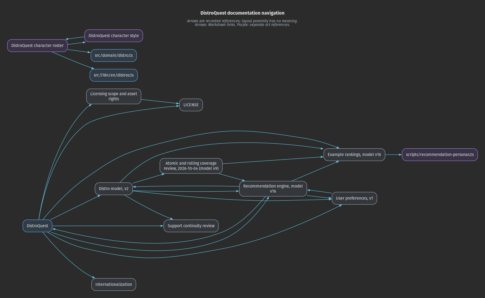
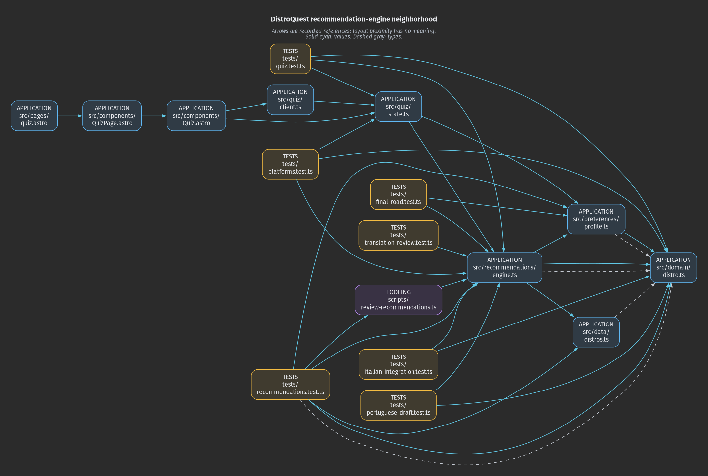

# DistroQuest relationship maps

Generated from explicit file links and module references. Source files remain
canonical; these maps are disposable. Placement adds no relationships.

```sh
python3 -B scripts/relationship_graph/refresh.py --check
python3 -B scripts/relationship_graph/refresh.py --refresh
```

Run from the repository root. Check is read-only: exit 0 means current, 1 stale,
and 2 error. Refresh regenerates this directory; do not edit its contents.
Both modes parse files without executing application modules or starting a server.

## Questions

1. Which documentation is reachable from the root README?
2. Which application, tooling, and test files reference the ranking engine?
3. Which dependency cycles involve type-only references?

## Documentation navigation

Scanned 11 Markdown files. The extraction has 15 nodes and 27 edges;
the view shows 15 nodes and 26 inter-file edges. Self-links stay in the data.



Files unreachable from the root README:

- `art/characters/ROSTER.md`
- `art/characters/STYLE.md`

The art roster and style guide intentionally form a separate reference pair.
Root reachability differs from having incoming links; this is not a repair request.

Documents without incoming links from another scanned document:

None.

Missing local targets: 0. Unchecked fragment occurrences: 30.
External URLs are counted, never fetched. Images are checked as resources rather
than relationship edges. Duplicate links retain every source occurrence.

## Recommendation-engine neighborhood

Scanned 122 code files; 463 resolved literal occurrences form 493 typed edges
across 141 nodes. Mixed declarations can contribute both value and type edges.



The view contains 17 nodes and 34 edges: the engine, its direct static
value-reference users and local dependencies, plus the English quiz route,
QuizPage, Quiz and client. Other locales are scanned but omitted from this view.
Views refuse more than 25 nodes or 50 edges rather than silently truncating.

The processed script in Quiz.astro records its bridge to quiz/client.ts.
The route/component/client/state/engine chain is a static dependency path,
not proof of runtime execution order.

Direct static value-reference users of the engine (9):

- `scripts/review-recommendations.ts`
- `src/quiz/state.ts`
- `tests/final-road.test.ts`
- `tests/italian-integration.test.ts`
- `tests/platforms.test.ts`
- `tests/portuguese-draft.test.ts`
- `tests/quiz.test.ts`
- `tests/recommendations.test.ts`
- `tests/translation-review.test.ts`

Resolved static value cycles: 0.
Groups with cycles across all reference kinds: 1.
Literal dynamic imports are excluded from the static-value cycle check.

All-reference group (12 files):

- `src/i18n/catalog.ts`
- `src/i18n/es.ts`
- `src/i18n/es/explanations.ts`
- `src/i18n/es/platforms.ts`
- `src/i18n/es/quiz.ts`
- `src/i18n/index.ts`
- `src/i18n/it.ts`
- `src/i18n/it/explanations.ts`
- `src/i18n/pt.ts`
- `src/i18n/pt/explanations.ts`
- `src/i18n/pt/platforms.ts`
- `src/i18n/pt/quiz.ts`

A type-closing cycle records a type contract; it does not establish a runtime defect.

Unresolved or unsupported code forms:

- `scripts/review-translations.ts:46`: computed_import

## Scope and reproduction

- Inputs are tracked and non-ignored untracked Markdown, TS, TSX, Astro, JS and MJS.
  AGENTS.md and symlinks are not scanned as documentation. Ignored files, generated
  reports and this graph toolkit are excluded. Explicit code links become terminal targets.
- Relative Markdown paths are resolved from the referring file, with URL decoding.
  Missing targets, unsupported syntax, symlinks and boundary escapes are reported.
  Anchors are recorded but not validated; HTML anchor links and wiki links are unsupported.
- Code uses the installed TypeScript resolver and Astro compiler. Literal imports,
  re-exports, types, frontmatter and processed scripts retain exact source locations.
  Computed imports, require, globs, script src and unprocessed scripts are reported
  without guessing targets. Packages and built-ins are terminal nodes.
- This is not a call graph, bundle analysis, runtime coverage or dead-code detector.
  Astro file routes need no incoming imports. No semantic edges are inferred.
- Requirements: Python 3 standard library, existing npm dependencies, Graphviz dot
  and Fira Sans (regular, bold and italic). No extra npm or Python dependencies.
  Fonts and renderer versions can affect pixels; identical environments reproduce bytes.
- The versioned Modern Dark preset is scripts/relationship_graph/modern_dark.json.
  There is no runtime dependency on another repository.
- Refresh after changes to scanned inputs, link targets, resolver configuration,
  parser versions or this toolkit. Use --export /tmp/new-directory for a disposable trial.
  Stop and reconsider the view if its bound fails or the map loses explanatory value.

Fixture tests:

```sh
python3 -B -m unittest discover -s scripts/relationship_graph -p "test_*.py"
node --test --experimental-test-isolation=none scripts/relationship_graph/test_code.mjs
```

Only this report, two PNGs and snapshot.json are retained. For SVG, DOT, JSONL
with per-occurrence provenance, and diagnostics, export the complete bundle:

```sh
python3 -B scripts/relationship_graph/refresh.py --export /tmp/distroquest-graph-export
```

snapshot.json records input/tool fingerprints and artifact hashes. Generated outputs
and this toolkit can be removed without changing the application.

Snapshot fingerprint: `3dbc3cbefe518cb55077af854c68c713e987d1671f90537008d4fb21eef8c323`.
